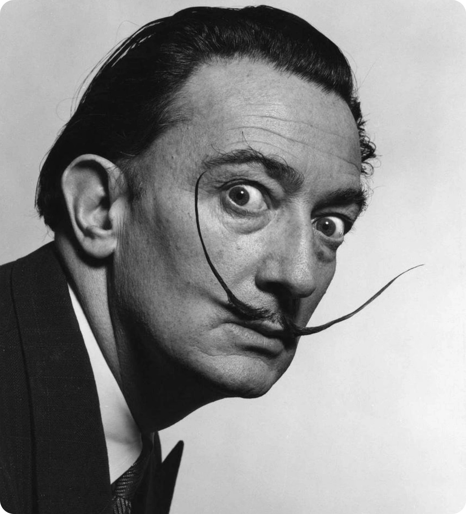

# Outside-In Glitch

A Python tool that turns an image into a geometric glitch. The source is mirrored into four symmetric quadrants, then cut into strips that are rebuilt from the outer edges toward the center, first along the horizontal axis, then along the vertical one. The output is a grid of square cells filled with mirrored fragments of the original picture.

---


## Example
 
| Source | Result (40 strips) |
|---|---|
|  |  |


## How it works

The pipeline has three phases.

**Phase 1 - Kaleidoscope.** The source is flipped left-right and appended to its right. The widened image is then flipped top-bottom and appended below. The result has four symmetric quadrants and twice the source size on each axis.

**Phase 2 - Vertical strips.** With $n$ strips requested and a base width $w$, the width is first adjusted to the nearest multiple of $n$:

$$w' = n \cdot \mathrm{round}\left(\frac{w}{n}\right)$$

This moves the width by at most $n/2$ pixels. The image is then cut into $n$ strips of width $s = w'/n$, indexed from $0$ to $n-1$, and rebuilt in the order $0, n-1, 1, n-2, 2, n-3, \dots$ When $n$ is odd, the middle strip comes last.

**Phase 3 - Horizontal strips.** Cells must be squares, so the strip height is also $s$. The number of rows is

$$r = \mathrm{round}\left(\frac{h}{s}\right)$$

and the height is adjusted to $r \cdot s$ before the image is cut into rows and reordered with the same outside-in order.

Because of the kaleidoscope, strip $i$ is the exact mirror of strip $n-1-i$ along both axes. Taking strips from both ends therefore places each one next to its own reflection, which is what produces the zigzag pattern.

## Project structure

```
.
|-- README.md
|-- requirements.txt
|-- outside_in.py
|-- examples/
    |-- source.jpg
    |-- result.jpg
```

## Installation

Python 3.9 or later is required.

```sh
python -m venv .venv
source .venv/bin/activate
pip install -r requirements.txt
```

## Usage
 
```sh
python outside_in.py examples/source.jpg -o examples/result.jpg -n 40
```
 
| Option | Description | Default |
|---|---|---|
| `input` | source image | required |
| `-o`, `--output` | output path, format follows the extension | `<input>_glitch`, same extension as the input |
| `-n`, `--strips` | number of vertical strips | 40 |
| `-g`, `--grayscale` | convert the source to grayscale before processing | off |
 
The source can be a JPG, a PNG or any other format Pillow reads. The `-g` option has no effect on an image that is already grayscale. The EXIF orientation of photos is applied and the alpha channel is discarded.
 
A square source with 40 to 50 strips gives a balanced result, and fewer strips make larger cells. The output is about twice the size of the input on each axis. Non-square sources are supported: the number of rows adapts so that cells stay square.

